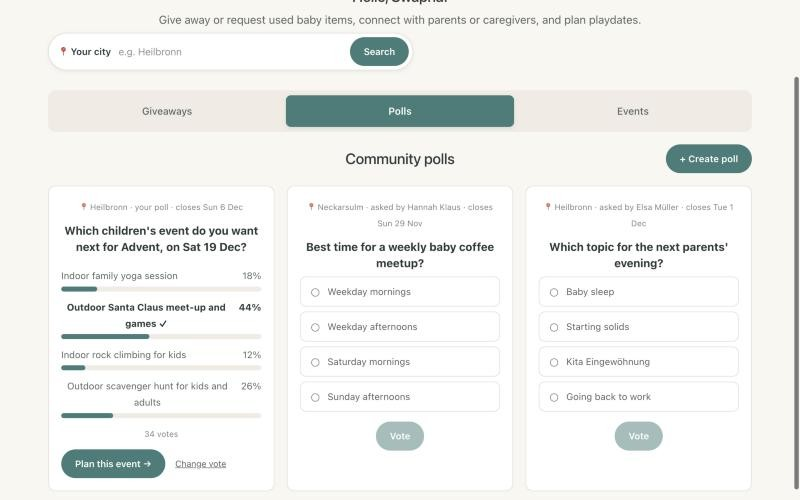

# MOM-KIOSK 👶

A community web app for new parents/caregivers: connect with other parents nearby,
give away used baby items, and organise events like playdates.

> Development Status: Personal project, actively in development.
> Frontend is functional with product(give-aways) Page and product details page working; the Node.js backend is currently being built.
> Right now, the Give Aways and Products are considered the same. But in future, there is a type included in every product which determines if it's a GiveAway or is sold for a price. 
## Features

- [x] Tabbed View of Giveaways, Polls and Events 
- [x] Products Listed under Products tab
- [x] Product Details Page with Image Carousel on click on one Product
- [x] Polls and Events Tabs are just placeholders for now
- [x] Event creation for playdates
- [ ] User accounts and authentication

## Tech Stack

| Layer    | Technology                          | Status      |
|----------|-------------------------------------|-------------|
| Frontend | React, TypeScript, Vite             | In progress |
| Backend  | Node.js, Express, TypeScript        | In progress |
| Database | planned: PostgreSQL or MongoDB      | Planned     |
| Testing  | planned: Vitest / Jest, Supertest   | Planned     |
| CI/CD    | GitHub Actions                      | Planned     |

## Project Structure

    mom-kiosk/
    ├── src/            # React frontend
    ├── public/         # Static assets
    ├── server/         # Node.js / Express REST API
    │   └── src/
    │       └── index.ts
    ├── vite.config.ts  # Includes /api proxy to the backend
    └── package.json

## REST API

Base URL (local): `http://localhost:3000/api`

| Method | Endpoint         | Description            | Status      |
|--------|------------------|------------------------|-------------|
| GET    | `/products`         | List all giveaway items | Done |
| GET    | `/products/:id`     | Get one item            | Done |
| POST   | `/products`         | Create a new item       | Done |
| DELETE | `/products/:id`     | Delete an item          | Done |

Responses use standard HTTP status codes (`201` Created, `204` No Content,
`400` Bad Request for invalid input, `404` Not Found).

## Getting Started

### Prerequisites
- Node.js 24.x and npm 11.x

### Run the backend

    cd server
    npm install
    echo "ANTHROPIC_API_KEY=your-key-here" > .env
    npm run dev

The API runs on `http://localhost:3000`. `.env` is git-ignored.

### Run the frontend

    npm install
    npm run dev

The app runs on `http://localhost:5173`. Requests to `/api` are proxied to the backend via `vite.config.ts`.

## Deployment

| Part     | Platform      | Settings                                                                           |
| -------- | ------------- | ---------------------------------------------------------------------------------- |
| Frontend | Vercel        | Vite preset, root `./`, `vercel.json` rewrites `/api/*` to Render                  |
| API      | Render (free) | Root `server`, build `npm install`, start `npm start`, env var `ANTHROPIC_API_KEY` |

Both redeploy automatically on every merge to `main`.

## Roadmap

1. PostgreSQL with migrations (Neon) for products, polls and events
2. Creating giveaways with photo upload to object storage
3. Login, authentication and authorisation, so votes and requests move to the server
4. Unit and component tests (Vitest, Testing Library) and API tests (Supertest)
5. GitHub Actions CI: lint, type-check, test and build on every pull request

## Screenshots

**Item details with the "I am interested" flow**

**Community polls**

**AI-written event description**

**Upcoming events**

**On mobile**

