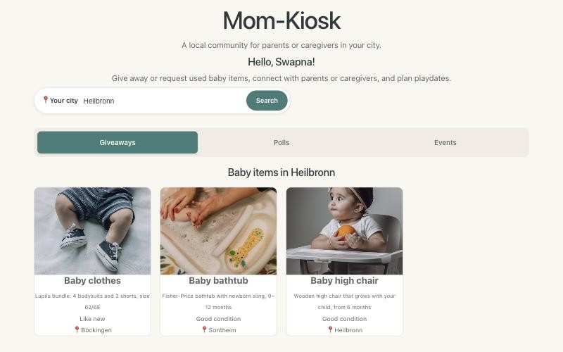
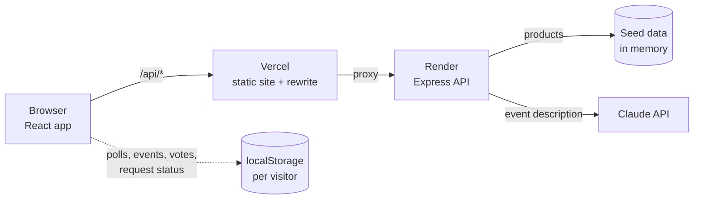
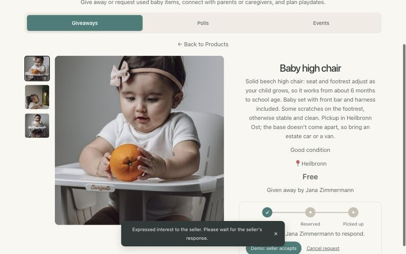
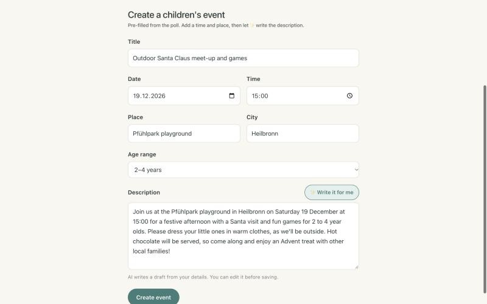
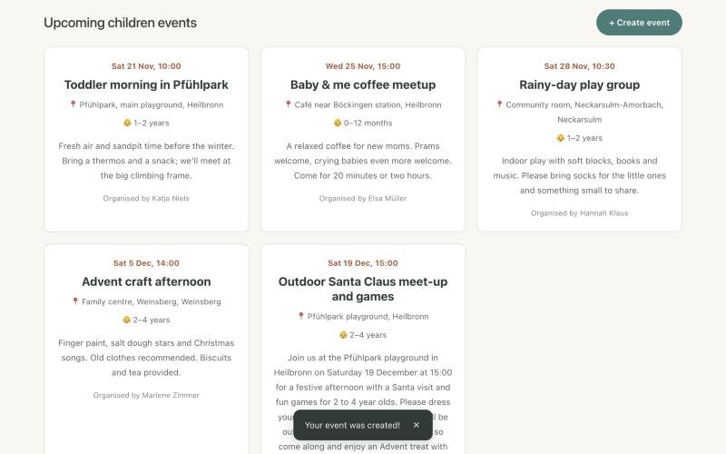
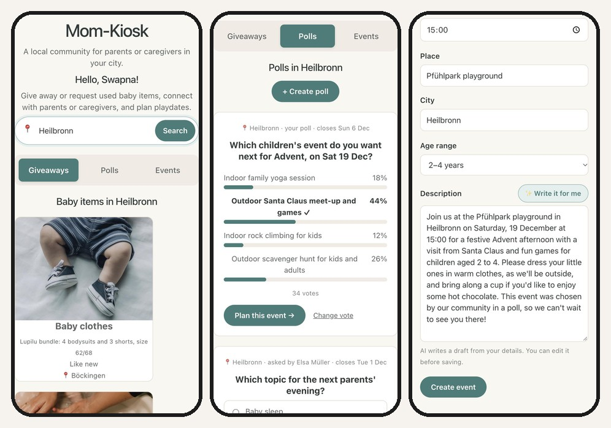

# MOM-KIOSK 👶

A community web app for new parents and caregivers: give away outgrown baby items to families nearby, vote in local polls, and organise playdates, with an AI helper that writes event descriptions.

**Live demo:** [mom-kiosk.vercel.app](https://mom-kiosk.vercel.app) · **Author:** [Swapna Srinivasan](https://swapna-srinivasan-portfolio.vercel.app)

> **Status:** personal project, actively in development. The frontend and a Node.js API are deployed. Polls, events, votes and requests are stored per visitor in the browser for now; a database with user accounts is next on the roadmap.

## Try it in 2 minutes

1. **Search your city:** type `Heilbronn`, or `Munich` / `München` (English and German names both work). One search filters giveaways, polls and events.
2. **Open an item** and click **I am interested**. A status stepper and a notification show the request.
3. **Vote in the Advent poll** on the Polls tab, then click **Plan this event**.
4. The event form opens pre-filled. Add a time and place, then click **✨ Write it for me**: Claude drafts the description.
5. **Create the event.** It appears in the Events list, sorted by date.

The free backend sleeps when idle, so the first request after a break can take up to a minute.

## Features

- [x] **Giveaways** listed from the REST API, with a detail page and image carousel
- [x] **City search** across all tabs: English and German city names (`Munich` = `München`), districts (`Sontheim` → Heilbronn), validation for unknown cities, and the city kept in the URL (`?city=Heilbronn`), so links can be shared
- [x] **"I am interested" flow:** status stepper (Requested → Reserved → Picked up), toast notification, and a demo button that simulates the seller's reply
- [x] **Community polls:** vote, see results as bars, change your vote, and create your own poll (2–4 options, validated)
- [x] **Plan an event from a poll:** the poll's creator can turn the winning option into a pre-filled event
- [x] **Events:** list of upcoming playdates and a create form with validation
- [x] **AI event description:** "Write it for me" turns a few words into a friendly description via the Claude API
- [x] **Deployed:** frontend on Vercel, API on Render; every merge to `main` deploys both automatically
- [ ] Database (PostgreSQL) and user accounts
- [ ] Creating giveaways with photo upload
- [ ] Automated tests and a CI pipeline

## Tech stack

| Layer                 | Technology                                                                     | Status  |
| --------------------- | ------------------------------------------------------------------------------ | ------- |
| Frontend              | React 19, TypeScript, Vite, React Router                                       | Done    |
| Backend               | Node.js, Express, TypeScript (run with `tsx`)                                  | Done    |
| AI                    | Claude API (Claude Haiku) via `@anthropic-ai/sdk`, called only from the server | Done    |
| Hosting               | Vercel (frontend), Render (API)                                                | Done    |
| Continuous deployment | Vercel and Render auto-deploy on every merge to `main`                         | Done    |
| Database              | PostgreSQL                                                                     | Planned |
| Testing               | Vitest, React Testing Library, Supertest                                       | Planned |
| CI                    | GitHub Actions (lint, type-check, test, build)                                 | Planned |

## Architecture

- The frontend always calls `/api/...`. Locally, Vite proxies it to `localhost:3000`; in production, a Vercel rewrite forwards it to Render. No CORS setup is needed.
- The Claude API key lives only on the server (`ANTHROPIC_API_KEY`), never in the browser.

## Vision: one place for local family life

Parents today search many places: family education centres, children's bazaars (Kinderbasare), city event calendars and second-hand marketplaces. MOM-KIOSK aims to bring these together per city, while keeping its core free and parent-to-parent.

**How external sources will be connected**

| Approach                               | Used when                            | Example                                                                    |
| -------------------------------------- | ------------------------------------ | -------------------------------------------------------------------------- |
| Official feed or API (iCal, RSS, REST) | The provider offers one              | Importing an organisation's event calendar                                 |
| Organisation accounts                  | The provider has no feed             | Family centres or Kinderbasar teams post their own events                  |
| Link-out cards                         | Content stays on the provider's site | "More baby items in Heilbronn" on a second-hand marketplace                |
| ~~Scraping~~                           | Never                                | Breaks terms of use and database rights, and fails whenever a page changes |

**Planned changes to the event model**

- `source`: `community` (posted by a parent) or `organisation` (posted by a verified provider)
- `price`: `free` or `paid`, with a **"Free only"** filter
- `externalUrl` and provider name for attribution, so paid courses link to the provider instead of being joined in MOM-KIOSK

## Design decisions

- **One shared location filter**, typed as a union (`all` | `city` | `invalid`), so "nothing searched" and "invalid search" can't be confused. It is derived from the URL, so Back, refresh and shared links all work.
- **AI safeguards:** input fields are length-limited, the model's output is checked before use, the user's own title is never overwritten, and an hourly budget cap keeps a public demo from draining API credits.
- **Per-visitor demo state:** without accounts, the server can't tell visitors apart, so votes and requests stay in each visitor's browser. They move to the server together with login.
- **Plain data for polls:** polls store an optional event date instead of functions, so user-created polls can be saved as JSON today and sent to an API later.

## Project structure

    mom-kiosk/
    ├── src/                      # React frontend
    │   ├── api/                  # API calls (products, AI)
    │   ├── components/           # Cards, carousel, stepper, toast, search…
    │   ├── data/                 # Cities, example polls and events
    │   ├── hooks/                # useEvents, usePolls, usePollVotes, useRequestStatus
    │   ├── models/               # TypeScript types
    │   ├── pages/                # Products, Polls, Events (list + create pages)
    │   └── utils/                # Date helpers
    ├── public/images/            # Product photos
    ├── server/                   # Node.js / Express REST API
    │   └── src/
    │       ├── index.ts          # Routes, AI budget guard
    │       ├── ai/               # Claude call for event descriptions
    │       ├── data/             # Product seed data
    │       └── models/
    ├── vercel.json               # /api rewrite to Render + SPA fallback
    └── vite.config.ts            # /api proxy for local development

## REST API

Base URL (local): `http://localhost:3000/api` · Production: `https://mom-kiosk.vercel.app/api`

| Method | Endpoint                | Description                                                 |
| ------ | ----------------------- | ----------------------------------------------------------- |
| GET    | `/health`               | Server status, used to wake the server before a demo        |
| GET    | `/products`             | List all giveaway items                                     |
| GET    | `/products/:id`         | Get one item (`404` if it doesn't exist)                    |
| POST   | `/ai/event-description` | Draft an event title and description from the given details |

`POST /ai/event-description` takes `title`, `date`, `time`, `place`, `city`, `ageRange` and `notes` (all optional strings, length-limited) and returns `{ "title": "...", "description": "..." }`. It answers `400` if neither a title nor notes are given, `429` when the hourly AI budget is used up, and `502` if the AI call fails.

## Getting started

### Prerequisites

- Node.js 24.x and npm 11.x
- An Anthropic API key, only needed for the AI feature

### Run the backend

    cd server
    npm install
    echo "ANTHROPIC_API_KEY=your-key-here" > .env
    npm run dev

The API runs on `http://localhost:3000`. `.env` is git-ignored.

### Run the frontend

    npm install
    npm run dev

The app runs on `http://localhost:5173`. Requests to `/api` are proxied to the backend via `vite.config.ts`.

## Deployment

| Part     | Platform      | Settings                                                                           |
| -------- | ------------- | ---------------------------------------------------------------------------------- |
| Frontend | Vercel        | Vite preset, root `./`, `vercel.json` rewrites `/api/*` to Render                  |
| API      | Render (free) | Root `server`, build `npm install`, start `npm start`, env var `ANTHROPIC_API_KEY` |

Both redeploy automatically on every merge to `main`.

## Roadmap

1. PostgreSQL with migrations (Neon) for products, polls and events
2. Creating giveaways with photo upload to object storage
3. Login, authentication and authorisation, so votes and requests move to the server
4. Unit and component tests (Vitest, Testing Library) and API tests (Supertest)
5. GitHub Actions CI: lint, type-check, test and build on every pull request

## Screenshots

**Item details with the "I am interested" flow**

**Community polls**

**AI-written event description**

**Upcoming events**

**On mobile**

